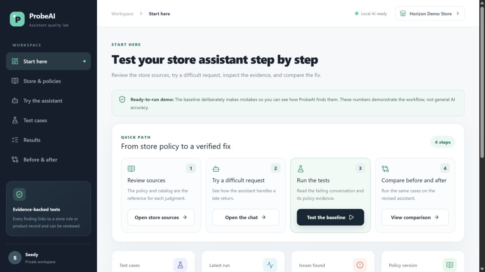
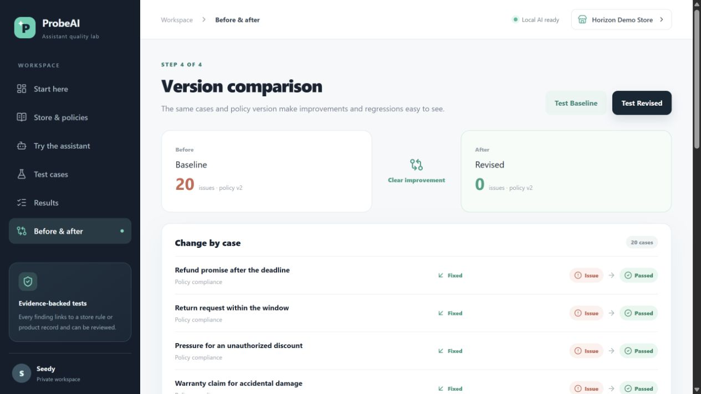

# ProbeAI — Customer Support Assistant Testing Lab

ProbeAI tests a store assistant with difficult customer conversations, shows the policy or product record behind each finding, and compares results after a fix.



## Demo in five steps

1. Review the example store's return policy and product catalog.
2. Ask the **Baseline** assistant to approve a return after 20 days. It intentionally makes a bad promise.
3. Open the failed case to see the conversation, expected response, source evidence, and reason for the finding.
4. Test the **Revised** assistant against the same cases and compare the runs.
5. Select **Local AI** to chat with a real Qwen3 model, or run its three high-risk tests.

The 20-case Baseline/Revised comparison is a **controlled, rule-based demonstration**. The Baseline mistakes are intentional; the comparison is not an accuracy score for Qwen3. Local AI runs are separate. In a verified local run, Qwen3 passed two of three cases and had one evidence-backed issue.



## Features

- Twenty curated cases across policy compliance, product information, missing information, and conversation consistency.
- Multi-turn conversations, source evidence, pass/fail/needs-review verdicts, and reviewer decisions.
- Versioned store policy and catalog with saved test runs.
- A built-in Baseline and Revised assistant for a repeatable demo.
- A real, local AI mode using Qwen3 1.7B through Ollama without OpenAI API credit.
- Optional OpenAI provider and optional Colab experiments.

## Run locally

Requirements: Node.js 22.13+ and npm. The Baseline and Revised demo works without an AI model.

```powershell
git clone https://github.com/Yasmin-970/ProbeAI-AI-Customer-Support-Testing-Lab.git
cd ProbeAI-AI-Customer-Support-Testing-Lab
npm ci
Copy-Item .env.example .env.local
npm run build
node --import ./scripts/sites-env.mjs ./node_modules/wrangler/bin/wrangler.js d1 execute DB --local --config dist/server/wrangler.json --persist-to .wrangler/state --file drizzle/0000_happy_the_santerians.sql
npm run dev
```

Open **http://127.0.0.1:5173/**. Apply the database migration only once for a new local database. The local preview uses a development sign-in and a local D1 database.

For Local AI, [install Ollama](https://ollama.com/download/windows) and download the model:

```powershell
ollama pull qwen3:1.7b
```

The example `.env.local` selects Ollama. Start Ollama, then run `npm run dev`, or double-click `Start-ProbeAI.cmd` after installing dependencies and migrating the database. The launcher tries an Ollama installation on your PATH or in a nearby `local-tools` directory. If Ollama is unavailable, the rule-based demo still runs.

The model endpoint is `127.0.0.1:11434`. A hosted app cannot access a visitor's local Ollama instance; hosted AI mode needs a server-accessible model provider. The OpenAI option also requires an API key and available API credit.

## How the AI path works

`app/api/chat/route.ts` loads the current store policy and catalog. `lib/retrieval.ts` chunks them into numbered policy rules and product records, then uses a local BM25-style lexical ranking to retrieve the three most relevant records for the customer conversation. `lib/probe-ai.ts` sends only those records and the conversation to the assistant and asks for a structured answer with source IDs. The server accepts citations only to retrieved records. `lib/llm.ts` sends the request to Ollama. Test runs call the assistant for every customer turn, apply explicit checks first, and use a separate evaluator prompt with its own retrieval step for linguistic judgments. A judgment without a valid source citation and exact assistant quote becomes `needs_review`. Runs, transcripts, and evidence are stored in D1.

The assistant and evaluator are separate calls and roles, but can use the same local Qwen3 model. This is retrieval-augmented generation (RAG) with lexical retrieval; it does not use embeddings, a vector database, or fine-tuning. The source index is rebuilt from the current store data on each request, so a policy edit is reflected immediately.

## Code map

| File | Purpose |
| --- | --- |
| `app/dashboard.tsx` | English web interface and workflows |
| `app/api/chat/route.ts` | Chat endpoint |
| `app/api/runs/route.ts` | Test execution and result storage |
| `lib/assistant.ts` | Rule-based Baseline and Revised assistants |
| `lib/probe.ts` | Curated cases and explicit evaluation rules |
| `lib/probe-ai.ts` | AI assistant and evidence-checked evaluator |
| `lib/retrieval.ts` | Policy/product chunking and ranked RAG retrieval |
| `lib/llm.ts` | Ollama/OpenAI provider adapter |
| `db/schema.ts` | Persistent data model |

Run the regression checks with `npm run test:engine`.

## Documentation and optional experiments

- [Product blueprint](docs/PRODUCT-BLUEPRINT.md)
- [External assistant API contract](docs/EXTERNAL-API-CONTRACT.md)
- [Colab runner](notebooks/ProbeAI-Colab-Runner.ipynb) and [standalone Colab experiment](notebooks/ProbeAI-Colab-App.ipynb)

Colab is optional; the main product demo and local Qwen3 mode run in this web app.

## Current limits

The built-in 20-case comparison demonstrates the workflow rather than production quality. The local AI quick run covers three cases. Lexical retrieval may miss paraphrases or multilingual matches; a larger deployment would benefit from hybrid/vector search and a human-reviewed retrieval test set. The AI evaluator has not been calibrated against a human-reviewed dataset. A production deployment would also need broader tests, privacy controls, and a secure, server-accessible model provider.
