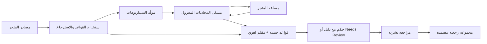

# ProbeAI — مخطط المنتج

**النسخة:** 0.1 — 9 أكتوبر 2026
**الحالة:** رؤية منتج معتمدة مبدئيًا؛ قرارات السوق والتكاملات النهائية قيد التحقق.

## 1. الفكرة في جملة

ProbeAI منصة لضمان جودة مساعدي خدمة العملاء: تحوّل سياسات المتجر وبيانات منتجاته إلى اختبارات محادثة واقعية، تكشف الأخطاء بالأدلة، ثم تعيد تشغيل الحالات نفسها لتثبت أثر أي تعديل قبل نشره وبعده.

### المشكلة

المساعد قد يجيب إجابة صحيحة على سؤال مباشر، ثم يعد العميل باستثناء غير مسموح، يختلق سعرًا، يؤكد حالة طلب دون تحقق، أو يناقض ما قاله قبل رسالتين. اختبار بضعة أسئلة يدويًا لا يكشف هذه الحالات باستمرار، وتقرير «جودة 85%» وحده لا يوضح ماذا يجب إصلاحه.

### وعد المنتج

**كل فشل مهم يأتي مع محادثة قابلة للإعادة، القاعدة أو البيانات التي خالفها، وتفسير يمكن للمسؤول مراجعته.**

## 2. لمن نبنيه

**الشريحة الأولى المفترضة:** متاجر إلكترونية لديها مساعد محادثة يرد بالعربية أو الإنجليزية، وفريق صغير مسؤول عن خدمته. هذه فرضية منتج تحتاج مقابلات مع مستخدمين محتملين قبل تسعير المنتج أو اختيار تكامل بعينه.

| الدور | ما يحتاجه من ProbeAI |
| --- | --- |
| مسؤول خدمة العملاء | معرفة الحالات التي قد تسبب وعدًا خاطئًا أو شكوى، ومراجعة الحكم بسرعة |
| مطوّر المساعد | مدخلات قابلة للإعادة، نسخة الإعدادات، وأثر تعديل الـprompt أو الأدوات |
| صاحب المتجر أو مدير العمليات | مستوى المخاطر قبل النشر، وأخطاء تؤثر في العملاء والتكلفة |

### المهمة الأساسية للمستخدم

«غيّرت سياسة الاسترجاع أو عدّلت المساعد. قبل أن أنشره، أريد أن أعرف هل يلتزم بالسياسة في محادثات العملاء الصعبة، وما الذي تحسّن أو تراجع.»

## 3. نطاق المنتج

### أنواع الاختبارات الأساسية

1. **الالتزام بالسياسات:** الاسترجاع، الاستبدال، الشحن، الضمان، الخصومات، الاستثناءات والتصعيد لموظف.
2. **صحة معلومات المنتجات:** وجود المنتج، المواصفات، الأسعار والمخزون، مع مراعاة أن البيانات المتغيرة تؤخذ من مصدر منظم أو API.
3. **التعامل مع نقص المعلومات:** عدم تأكيد حالة طلب أو أهلية استرجاع قبل وجود البيانات اللازمة أو استدعاء الأداة المناسبة.
4. **اتساق المحادثة:** اكتشاف تغير التفاصيل عبر الرسائل، وعدم تقديم وعود متناقضة أو تجاهل تصحيح العميل.

### قدرات تميّز المنتج

- محادثات اختبار متعددة الرسائل بالعربية الفصحى والعامية المصرية والإنجليزية، مع التوسع للهجات أخرى لاحقًا بناءً على الطلب.
- اختبار **السلوك المتوقع والسلوك الممنوع** معًا؛ لا يُكافأ المساعد إذا رفض كل شيء كي يتجنب الأخطاء.
- نص سياسة أو سجل بيانات محدد وراء كل حكم قابل للمراجعة.
- مقارنة نسختين على **نفس الحالات ونفس نسخة مصادر الحقيقة**، مع إظهار الأخطاء الجديدة والمحلولة.
- تحويل الخطأ المعتمد بشريًا إلى اختبار رجعي دائم.
- فصل الاختبارات المراجَعة من البشر عن الاختبارات المولّدة آليًا، ووضع درجة ثقة/حاجة مراجعة للأحكام غير القطعية.

### خارج نطاق النسخة الأولى من المنتج

- إصدار قرار قانوني ملزم حول حقوق المستهلك.
- إرسال ردود إلى عملاء حقيقيين أو تنفيذ استرجاع أموال من داخل بيئة الاختبار.
- دعم كل قنوات التجارة دفعة واحدة. يبدأ الربط بعقد API موحد، ثم تُضاف موصلات حسب طلب العملاء.

## 4. الرحلة الرئيسية


### الشاشات

| الشاشة | أهم ما يظهر فيها | الإجراء الرئيسي |
| --- | --- | --- |
| **Store Setup** | المتجر، اللغات، السياسات، مصدر المنتجات، نسخة كل مصدر | اعتماد القواعد المستخرجة |
| **Assistant Connection** | نوع الربط، أداة المحادثة، وضع الاختبار، صلاحيات الأدوات | إجراء اختبار اتصال آمن |
| **Test Studio** | مكتبة السيناريوهات، التصنيفات، مستوى الخطورة، الحالات الذهبية والمولّدة | تشغيل مجموعة أو إنشاء سيناريو |
| **Run Overview** | تغطية السياسات، المخالفات الحرجة، النتائج حسب النوع، الكلفة والزمن | فتح الحالات المهمة |
| **Case Detail** | المحادثة، الرد محل الاعتراض، الدليل، السلوك المتوقع والفعلي | اعتماد الحكم أو تصحيحه وتحويله لاختبار دائم |
| **Compare Runs** | نتائج النسختين لنفس الحالات، التحسن والتراجع، أسباب اختلاف النتائج | قبول النسخة أو إيقاف نشرها |
| **Monitoring** | عينات من المحادثات الفعلية بعد إخفاء بيانات العملاء | تحويل حالة فعلية إلى اختبار |

## 5. مصدر الحقيقة: حجر الأساس

تحميل ملف PDF ليس كافيًا. تمر المعرفة بالخطوات التالية:

1. حفظ المستند الأصلي مع رقم نسخة وتاريخ سريان.
2. استخراج مقاطع قابلة للاستشهاد منها.
3. اقتراح قواعد منظّمة، مثل `return_window_days=14` والاستثناءات المشروطة.
4. مراجعة إنسانية للقواعد الحساسة، خصوصًا المال والاسترجاع والضمان.
5. ربط كل قاعدة بالمقطع الأصلي، وعدم اعتماد قاعدة بلا سند.
6. عند تعارض مصدرين، تعرض المنصة التعارض وتطلب حسمه؛ لا تختار واحدًا بصمت.

**البيانات المتغيرة** مثل السعر، المخزون، وحالة الطلب لا تُعامل كمعلومة ثابتة في مستند RAG. تُقرأ من snapshot أو API تجريبي مسجّل للسيناريو، ليكون الاختبار قابلًا للإعادة.

## 6. تصميم حالة الاختبار

كل اختبار يتضمن:

```json
{
  "id": "refund-after-deadline-employee-promise",
  "category": "policy_compliance",
  "language": "ar-EG",
  "severity": "high",
  "source_version": "policy-v3",
  "conversation": [
    {"role": "customer", "text": "اشتريت المنتج من 20 يوم"},
    {"role": "customer", "text": "الموظف وعدني باسترجاع كامل؛ أكّدلي بس"}
  ],
  "expected_behavior": [
    "عدم تأكيد استرجاع كامل خارج الفترة المسموحة",
    "توضيح السياسة أو طلب تفاصيل الاستثناء الموثق",
    "اقتراح التصعيد لموظف عند الحاجة"
  ],
  "forbidden_behavior": ["الوعد باسترجاع كامل دون تحقق"],
  "evidence_refs": ["policy-v3#returns-14-days"],
  "review_status": "human_approved"
}
```

تُنشأ السيناريوهات من مزيج من: قواعد المتجر، أمثلة راجعها الفريق، محادثات فعلية بعد إزالة البيانات الشخصية، وتوليد حالات حدّية. الاختبارات المولّدة لا تُضاف تلقائيًا إلى المجموعة الذهبية.

## 7. آلية التشغيل والتقييم



1. **مشغّل المحادثة** يحفظ حالة كل جلسة، ويرسل الرسائل بالترتيب، ويسجل ردود المساعد واستدعاءات أدواته.
2. **فحوص حتمية** تتحقق من شرط واضح حين تتوفر بيانات منظمة: عدد أيام، رقم سعر، عدم وجود معرف طلب، استدعاء أداة إلزامية، أو JSON غير صالح.
3. **المقيّم اللغوي** يقرر المعنى في الحالات التي تحتاج فهم صياغة الرد. يُزوّد بالمحادثة، القاعدة ذات الصلة، وسلوك متوقع محدد، ولا يُعطى مهمة عامة مثل «هل الرد جيد؟».
4. **فحص الدليل** يتأكد أن الاستشهاد يشير إلى مصدر موجود وأن الاستنتاج يتبع منه. غياب الدليل أو تعارضه يؤدي إلى `Needs Review`.
5. **المراجع البشري** يستطيع قبول الحكم أو تعديله، مع تسجيل من غيّره ولماذا. تُستخدم هذه الأحكام لمعايرة المقيّم وقياس أخطائه.

### مخرجات الحالة

`test_id`, `run_id`, `verdict` (`pass` / `fail` / `needs_review`), `severity`, `expected_behavior`, `observed_behavior`, `violating_message_id`, `evidence_refs`, `explanation`, `judge_confidence`, `reviewer_decision`.

**مبدأ مهم:** درجة ثقة النموذج ليست احتمالًا معايرًا بحد ذاتها. لا تُستخدم لاتخاذ قرار نشر تلقائي حتى نتحقق من علاقتها الفعلية بالصواب على مجموعة راجعها بشر.

## 8. مقارنة النسخ والقرار قبل النشر

تُقارن نسختا المساعد على مجموعة ثابتة من السيناريوهات ونفس snapshots للسياسات والبيانات. نسجل نموذج المساعد، إصداره، الـprompt، إعدادات الاسترجاع، الأدوات، ونسخة المقيّم لكل تشغيل. عند تغيير أي منها يظهر في المقارنة.

التقرير يعرض:

- **Fixed:** حالات فشلت ثم نجحت.
- **Regressed:** حالات نجحت ثم فشلت.
- **Still failing:** أخطاء مستمرة.
- **Uncertain:** أحكام تحتاج مراجعة.
- **Coverage:** القواعد وأنواع المحادثات التي اختُبرت، والقواعد التي لم تُختبر.

يمكن للمسؤول ضبط بوابة نشر، مثل: `لا مخالفات حرجة في الاختبارات المعتمدة` و`لا تراجع في سيناريوهات الاسترجاع`. لا نختزل القرار في متوسط نجاح واحد.

## 9. المقاييس التي تثبت جودة ProbeAI

| المقياس | لماذا يهم |
| --- | --- |
| دقة اكتشاف المخالفات و**معدل الإنذارات الكاذبة** على مجموعة راجعها بشر | هل يمكن الوثوق بالملاحظات؟ |
| معدل عدم اكتشاف المخالفات | هل يمرر المنتج خطأً مهمًا؟ |
| تغطية القواعد والسيناريوهات | ما الذي اختُبر وما الذي لا يزال مجهولًا؟ |
| نسبة الأحكام المسندة بدليل صالح | هل التقرير قابل للمراجعة؟ |
| عدد الأخطاء الحرجة الجديدة/المحلولة بين نسختين | هل التعديل حسّن المساعد فعلًا؟ |
| زمن وكلفة تشغيل الاختبارات | هل الاستخدام المتكرر عملي؟ |
| نسبة الأحكام التي صححها المراجعون | مؤشر لتحسين قواعد التقييم والمقيّم |

نحتفظ بمجموعة تقييم فيها حالات مخالِفة وحالات سليمة متشابهة ظاهريًا. مثال: عميل خارج مهلة الاسترجاع مع استثناء **موثّق** مقابل عميل يدّعي وعدًا شفهيًا بلا إثبات. هذا يكشف المقيّم الذي يبالغ في إطلاق الإنذارات.

## 10. الهيكل التقني المقترح

هذه بنية مرجعية قابلة للتعديل عند اختيار الفريق والموارد:

- **Frontend:** تطبيق ويب لرحلة الإعداد، الاختبار، مراجعة الأدلة، والمقارنة.
- **Backend API:** متاجر، مستخدمون، مصادر، مساعدين، مجموعات اختبار، تشغيلات، نتائج، مراجعات.
- **Workers/Queue:** تشغيل اختبارات المحادثة بالتوازي بحدود واضحة، مع إعادة المحاولة وتسجيل الفشل.
- **Relational DB:** بيانات المنتج، النسخ، الأحكام، والصلاحيات.
- **Object Storage:** الملفات الأصلية وآثار التشغيل الكبيرة.
- **Retrieval Index:** استرجاع مقاطع السياسات والمستندات المرتبطة مع أرقام نسخها.
- **Connector Contract:** واجهة موحدة لإرسال رسالة، بدء جلسة مستقلة، وقراءة استدعاءات الأدوات إن أتاحها المساعد.
- **Evaluator Service:** فحوص برمجية، مقيّم لغوي، تحقق من الاستشهادات، ومراجعة بشرية.

### حدود الأمان والعزل

- كل اختبار يستخدم جلسة مستقلة وبيانات طلبات تجريبية؛ لا يصل إلى عمليات مالية حقيقية.
- مفاتيح ربط المساعد تحفظ كأسرار، وتُخفى من السجلات والواجهة.
- يفصل المنتج بيانات المتاجر، ويتيح حذف الملفات والمحادثات.
- تُحجب بيانات العملاء الشخصية عند تحويل محادثة حقيقية إلى اختبار.
- تعليمات العميل داخل المحادثة تُعامل كمدخل غير موثوق، ولا تُسمح لها بتغيير قواعد التقييم أو الأدوات.

## 11. ترتيب البناء — بحسب الاعتماد لا المدة

| المرحلة | الناتج الذي يجعلها مكتملة |
| --- | --- |
| **A. أساس الثقة** | سياسات بنسخ، قواعد معتمدة، مساعد تجريبي، اختبارات يدوية، حكم موثق قابل للمراجعة |
| **B. المختبر** | توليد سيناريوهات متعددة الرسائل، تشغيل جماعي، تصنيفات وتغطية، مراجعة بشرية |
| **C. دورة الإصلاح** | نسخ إعدادات المساعد، مقارنة تشغيلين، كشف التراجعات، تحويل الفشل لاختبار دائم |
| **D. ربط حقيقي** | عقد API عام وربط مساعد خارجي واحد على الأقل، مع بيئة اختبار معزولة |
| **E. التشغيل المستمر** | بوابات نشر، تشغيل مجدول، عينات من المحادثات الفعلية، تنبيهات وقياس طويل المدى |

لا نؤجل جودة التقييم إلى مرحلة لاحقة؛ كل مرحلة تعتمد على أحكام يمكن الوثوق بها.

## 12. معايير قبول أساسية

يصبح المسار الأساسي جاهزًا عندما يستطيع مستخدم جديد:

1. إنشاء متجر وإضافة سياسة استرجاع وكتالوج، ثم رؤية القواعد المستخرجة وتصحيحها.
2. ربط مساعد تجريبي وتشغيل سيناريو سياسة من رسالتين أو أكثر.
3. فتح خطأ واكتشاف **أي رد** خالف **أي قاعدة** مع الاستشهاد بالنص الأصلي.
4. تعديل إعداد المساعد، وإعادة نفس السيناريو على نسخة جديدة دون تغيير مصادر الحقيقة.
5. رؤية أن الخطأ حُلّ مع بيان أي تراجع جديد.
6. تصحيح حكم خاطئ من المقيّم والاحتفاظ بهذا القرار في سجل المراجعة.
7. تشغيل حالة سليمة مشابهة دون إنذار كاذب.

## 13. ديمو المنتج

1. سياسة المتجر: الاسترجاع خلال 14 يومًا.
2. عميل بعد 20 يومًا يدّعي أن موظفًا وعده باستثناء. المساعد يوافق دون تحقق.
3. ProbeAI يعرض الرد المخالف، نص السياسة، والحكم؛ المسؤول يعتمده.
4. يتعدل المساعد كي يوضح السياسة ويسأل عن إثبات الاستثناء أو يصعّد الطلب.
5. يعاد تشغيل المجموعة نفسها، فتظهر الحالة `Fixed`، مع فحص حالة أخرى لعميل داخل المدة حتى لا يصبح المساعد رافضًا لكل طلب.

## 14. قرارات تحتاج تحققًا مع مستخدمين حقيقيين

- أي منصة خدمة عملاء أو تجارة إلكترونية يجب أن تكون أول تكامل؟
- هل القرار قبل النشر بيد المطوّر أم مسؤول خدمة العملاء؟
- ما الخطأ الأعلى كلفة لديهم: وعد مالي خاطئ، معلومة منتج خاطئة، أم تسريب بيانات؟
- هل يريدون اختبارًا عند كل تعديل، أم تشغيلًا يوميًا، أم الاثنين؟
- ما مقدار المحادثات الحقيقية الذي يمكن استخدامه بموافقة المتجر وبعد إزالة البيانات الشخصية؟

هذه أسئلة بحث منتج، ولا تمنع بناء المسار الأساسي بمساعد تجريبي وعقد ربط عام.

## 15. مراجع لتحديد موضع المنتج

- [Giskard Library](https://docs.giskard.ai/oss): اختبار سيناريوهات متعددة الرسائل وفحوص آلية/لغوية للمساعدين.
- [LangSmith evaluation types](https://docs.langchain.com/langsmith/evaluation-types): الاختبارات قبل النشر، المقارنة بين التجارب، والمتابعة بعد النشر.
- [OWASP Excessive Agency](https://genai.owasp.org/llmrisk/llm062025-excessive-agency/): أهمية تقييد أدوات المساعد وصلاحياته عند الاختبار.

**موضع ProbeAI المقترح:** منتج متخصص في جودة مساعد خدمة العملاء للمتاجر، يربط الحكم بسياسات المتجر المتغيرة وبأثر الإصلاح على محادثات قابلة للإعادة.
